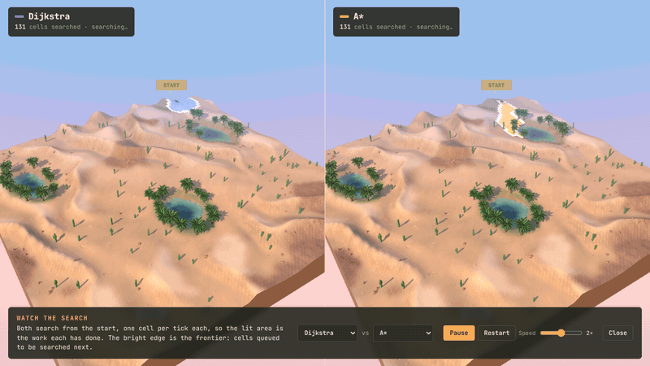
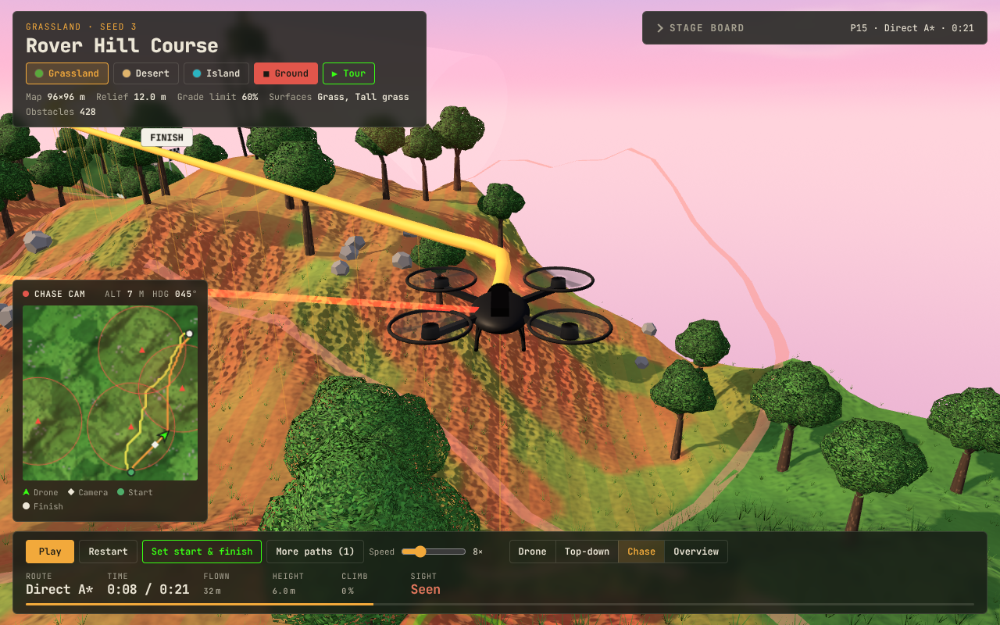

# Rover Hill Course — 3D Off-Road Robot Navigation

**[▶ Open the live demo](https://r0ck574r.github.io/Robot-Navigating-Obstacles/)**: it runs in your browser, on a laptop or a phone,
with nothing to install. Press **▶ Tour** for a guided run through all three maps (under two minutes).

A tracked rover, a matte-black rhomboid tank with a hedgehog coat of steel spikes, finds its way
across three hilly maps (grassland, desert dunes with oasis ponds, and a tropical island) using five pathfinding
algorithms. Each map opens empty: add any of its 20 preset routes, or set your own start and
finish, and the rover works out the quickest path over the hills while a follow drone films it,
at golden hour under a pastel sky.
A dashed line shows the shortest route a robot that ignores hills would take, so you can see what
reading the terrain buys you. You can **watch the search**: two planners side by side, cell by cell.
And the rover can drive **seeing only a few metres around it**, re-planning with **D\* Lite** as it
discovers the hills, the water and any roadblock you drop in its way. Press **✈ Air** and an attack drone
with one glowing red eye flies to the finish through the sky instead, keeping **out of the watchtowers'
sight** behind the hills.

Python generates the maps and picks the routes. The code that decides every route exists three times:
in Python (the reference), in C++ (a core 27 to 68 times faster, with a command-line tool and a Python
module) and in the browser's JavaScript. All three give the same routes, search the same cells and
report the same times, to the last bit.



## Show it to someone

- **The live demo** (https://r0ck574r.github.io/Robot-Navigating-Obstacles/) is the same page as `output/course_3d.html`,
  served by GitHub Pages from `docs/`. Shared links show a preview card with a picture of the
  desert oasis.
- **▶ Tour** (top left, or add `#tour` to the address) plays a guided loop: each map flies in and
  five planners race its showcase path; then the desert watches Dijkstra and A* search side by side,
  the island drives with a 5 m sensor and meets a roadblock, and the grassland rides along with the
  drone camera, then takes to the air: the attack drone flies its stealth route past the
  watchtowers. The overview lays every route side by side. A caption says what's happening at each
  step. Touch anything to take over; the tour doesn't change the paths your browser remembers.
- **Links to a view**: the address keeps up with what's on screen, so you can copy it and send it.
  [`#desert/p19/search`](https://r0ck574r.github.io/Robot-Navigating-Obstacles/#desert/p19/search) opens the search replay,
  [`#island/p20/sensor`](https://r0ck574r.github.io/Robot-Navigating-Obstacles/#island/p20/sensor) the sensor drive,
  [`#grassland/p15/air`](https://r0ck574r.github.io/Robot-Navigating-Obstacles/#grassland/p15/air) the air route,
  [`#desert/p19/drone`](https://r0ck574r.github.io/Robot-Navigating-Obstacles/#desert/p19/drone) the desert's path P19 past
  both oases with the drone camera, and `#tour/island` starts the tour on the island.
- **How fast it runs**: add `#bench` to the address for a frame-rate benchmark on that device, or
  `?fps` (or press F) for a live frame counter. See [Frame rate](#frame-rate).


## Run it yourself

You need [Python 3.10 or newer](https://www.python.org/downloads/) and [Git](https://git-scm.com/downloads).
Paste the lines one block at a time into a terminal (Terminal on Mac, PowerShell on Windows).

**1. Download the project**

```bash
git clone https://github.com/R0CK574R/Robot-Navigating-Obstacles.git
cd Robot-Navigating-Obstacles
```

**2. Install the packages** in a virtual environment

Mac or Linux:

```bash
python3 -m venv .venv
source .venv/bin/activate
pip install -r requirements.txt
```

Windows (PowerShell):

```powershell
py -m venv .venv
.venv\Scripts\Activate.ps1
pip install -r requirements.txt
```

If PowerShell says running scripts is disabled, run `Set-ExecutionPolicy -Scope CurrentUser RemoteSigned`
once and activate again.

**3. Build the 3D viewer** (takes about 15 seconds)

```bash
python main.py course
```

**4. Open it in your browser**

Mac:

```bash
open output/course_3d.html
```

Windows:

```powershell
start output\course_3d.html
```

Or double-click `output/course_3d.html` in your file browser. The page needs internet the first
time to load the 3D library (Three.js). Pick a map at the top left, then click **More paths** or
**Set start & finish** to send the tank driving.

> Just want to look? Open the [live demo](https://r0ck574r.github.io/Robot-Navigating-Obstacles/), or download
> `output/course_3d.html` from the repo and open it. Neither needs Python.

### More commands

Run these from the same terminal, with the virtual environment active.

| Command | What it does |
|---|---|
| `python main.py paths --map island` | List the 20 preset paths behind "More paths" |
| `python main.py route --map island --preset 3` | Race the five planners and the shortest route on preset P3 |
| `python main.py route --map desert --start 80,10 --goal 12,85` | Same, for your own START and FINISH (the `row, col` shown in the viewer) |
| `python main.py score-route route.json` | Score a route you drew in the viewer and copied |
| `python main.py explore --map desert --preset 19 --sensor 5` | Drive seeing only 5 m, re-planning with D\* Lite; `--block 40,30` drops a roadblock, `--prior map` starts from the map |
| `python main.py fly --map grassland --preset 15` | The air route: the stealth flight against the direct one, seconds in sight and flight time |
| `python main.py route --map desert --preset 19 --engine cpp` | Any of `route`, `explore` and `fly`, computed by the [C++ core](#the-c-core) instead (same output) |
| `python main.py parity` | The C++ core against Python on all 60 preset trips: identical results, and how much faster (about 3 minutes) |
| `python main.py explore-bench` | Every preset at 5, 10 and 20 m: time lost to not knowing, D\* Lite's work against A\* from scratch (about a minute) |
| `python main.py terrain-bench` | Hills, slope limit and obstacle sweep (about 25 seconds) |
| `python -m pytest -q` | Run the 209 tests (30 of them hold the C++ core against Python; skipped until it's built) |
| `python main.py demo`, `python main.py benchmark` | The original 2D grid version |

`python main.py course` writes the viewer twice: `output/course_3d.html` to open yourself, and
`docs/index.html`, the live demo, which adds the tags for link previews.

## Using the viewer

- **Pick a map**: Grassland, Desert or Island (top left). Every map opens with a short fly-in to the
  Overview, empty, with the rover parked in the middle and no route on the board.
- **More paths** (next to Set start & finish): 20 routes per map, all optional. Tick one and its quickest
  path over the hills is drawn as a labelled line (P1–P20). The first path you add starts the rover
  on it. **Drive** on any row sends the rover along that path with the drone following, and the
  stage board races the planners on it. Each row shows the quickest time against the shortest
  route's time (for example `1:21 vs 1:59`). **Add all** draws every path; **Remove all** clears
  the map again. Taking off the path being driven switches the rover to the last path you added.
- **The shortest route** (dashed white): the least-distance route between the same two points,
  which is what a robot that ignores hills would drive. The board ranks it with the planners, and
  the green line under the table spells out the difference, such as "1:21 instead of 1:59 on the
  shortest route, 39 s saved". The **Shortest route** chip hides the dashed line; **All planners**
  shows every planner's route; **Search area** colours the ground the selected planner searched.
- **▶ Watch the search** (on the stage board): see [below](#watch-the-search).
- **The D\* Lite row**: the same trip, driven seeing only a few metres. See
  [Driving with a limited sensor](#driving-with-a-limited-sensor-d-lite).
- **Set start & finish**: the camera rises to a top-down map with a START and a FINISH marker you
  can set in any order and move one at a time. Three ways, all equivalent:
  - **Click the map**: the next click places whichever marker is chosen (the **Start** / **Finish**
    buttons). After the START, the FINISH is chosen automatically; after that, clicks keep moving
    the FINISH. A ring under the pointer shows where it would land (red where it can't), and a
    readout gives the exact row, column and ground.
  - **Drag a flag**: press on a START or FINISH flag (its ring or its label) and drag it. A plain
    click on a flag chooses it. Dragging anywhere else still moves the map.
  - **Type a position**: `row, col` in the box next to each button (`40, 12`, `40 12` and
    `(40, 12)` all work), then Enter. Escape undoes the typing.

  Every placement is checked: water, rocks, trees, the other marker's cell, spots off the map,
  and walled-in pockets (cut off by obstacles or slopes too steep to drive) are refused with the
  reason. As soon as both markers are down, all five planners and the shortest route are planned
  and drawn; any later move re-plans at once. **⇄** swaps start and finish. Uphill becomes downhill,
  so the times change. **Drive** sends the rover; Escape or **Close** leaves. The positions use
  the same `row, col` as `python main.py route --start … --goal …`, which gives identical results.
- **Draw your own**: in the planner, once there's a start and finish, draw a route by
  clicking points (each joins the last with a straight line). Lines that hit an obstacle or a
  too-steep slope are refused with the reason. **Drive it** ranks your route against the planners,
  and **Copy your route** gives JSON you can score in Python.
- **Cameras**: Drone (follows from ~15 m up), Top-down, Chase, Overview. The Overview fits the whole
  map into the space the panels leave free, so every path label stays visible. Far views draw
  thicker lines, close views thin ones. Leaves and cacti between the camera and the rover dissolve,
  so a plant never hides it. The added paths, the route being driven and a drawn route are
  remembered per map in your browser.

## Watch the search

**▶ Watch the search** replays two planners finding the route, side by side on a split screen (one
above the other on a phone): Dijkstra and A\* by default, any two of the five. Both expand one cell
per tick, so the lit area is the work each has done, and the bright edge is the frontier: cells
queued but not yet searched. When a planner reaches the finish, its route traces back from the
finish to the start, and the caption sums up. On the desert's P19 both find the same 2:25 route,
but A\* searches 2.5× fewer cells; Weighted A\* against A\*, or Greedy against anything, shows the
other side of the trade: far less searching for a slower route.

How it's drawn: each planner records the order it searched the cells in and when it first queued
each one. That goes into a small texture, one texel per cell holding 16-bit step numbers, and the
ground's own shader colours every cell by comparing them with the current step. The whole
animation is one number per frame, so it adds no draw calls; the two halves are the same camera
drawn twice with a scissor, sharing one shadow map. Dragging turns both.

## Driving with a limited sensor: D\* Lite


Pick the **D\* Lite** row on the stage board and the rover drives the same trip seeing only 5 m
round itself (10 m and 20 m in its panel). It starts knowing nothing but where the finish is.
Unseen ground is dimmed and assumed flat and open, the cheapest it could be, so its plan (dashed)
is an optimistic guess. Each time it moves a cell it senses every cell within range, and anything
new can only make moves dearer: a hill, soft sand, water, a rock. When that breaks the plan, the
broken plan flashes red and [D\* Lite](https://cdn.aaai.org/AAAI/2002/AAAI02-072.pdf) (Koenig &
Likhachev, 2002) repairs it. It searches backwards from the finish and re-examines only the cells
whose cost to the finish the new ground changed, instead of planning again from scratch.
**Drop a roadblock** puts a steel tank trap anywhere on the map. It exists from that moment, and
the rover finds it when it comes into range.

The panel counts the re-plans, D\* Lite's work, and what A\* would have searched had it planned
again from scratch every time the plan broke. That's the fair comparison: costs only ever go up,
so a plan nothing broke is still the quickest. At every re-plan, D\* Lite's repaired plan is exactly
as quick as A\* from scratch on the same knowledge; the tests check that.

`robotnav/replan.py` is the reference (`python main.py explore` drives it from the command line);
the browser and the C++ core run line-for-line ports. Costs use `sqrt(run² + rise²)` rather than
`hypot`, so all three round alike. In a headless-browser test, 45 drives (three maps, three sensor
ranges, and roadblocks appearing mid-drive with each kind of prior knowledge) came out identical: the
same cells, the same work at every step, the same plans and the same cells sensed.

## The air route: a drone that stays out of sight



Press **✈ Air** (next to the map buttons) and the trip is flown instead: an attack drone, matte black
with four rotors and one glowing red eye, takes off at the start and lands at the finish. Four
watchtowers stand on the highest open ground, at least 30 m apart, each with a searchlight. A tower
sees 24 m, but only along a clear line of sight: the hills and trees between it and the drone block
the view, so a drone flying low behind a ridge is hidden (terrain masking, as with real radar).

The airspace is a stack of eight flight levels 3 m apart over the map's grid, the lowest just above
the lowest ground. A cell of airspace is free if it clears the ground, water, trees and rocks below
it by 2 m. The drone moves to any of the 26 neighbouring cells, but only if every cell the move
sweeps past is free, so it can't clip a hillside or a treetop. A move takes its length at 5 m/s,
plus 0.2 s per metre climbed. Two routes race on the board, both found with A\* and a straight-line
estimate (which never overestimates, so both are optimal for what they weigh):

- **Stealth A\*** (violet) also pays 10 s for every second inside a tower's sight, so it hugs the
  valleys and slips behind hills when it can.
- **Direct A\*** (amber) ignores the towers and flies the quickest line.

The ground shows where the danger is, hatched: red where a tower sees even the lowest flight, amber
where flying low keeps you hidden. While a tower sees the drone, its searchlight turns to follow it
and a red sight line joins them; the telemetry shows the height above the ground, the climb rate,
and **Seen** or **Hidden**.
`robotnav/airspace.py` is the reference (`python main.py fly`), and the browser runs a line-for-line
port: the same free cells, the same cells seen by each tower, and the same flights, checked in a
headless browser on every map.

## The rover

The rover is modelled on the British Mark IV/V "male" tank of 1917–18, at about a quarter scale (1.9 m long):


- **Rhomboid hull**: the tracks run right round each side frame (high front horns, a long sloped
  nose, a flat top run, a sloped rear). The track is 55 plates a side, each with raised grousers.
  They move with the ground speed, so the plates under the tank stay put on the ground while it drives.
- **Sponsons** on both sides with an angled lower face and a short gun in a ball mount. The guns
  swing toward the next bend and sweep from side to side at the finish.
- **A raised cab** at the front of the roof with a hatch, vision ports with dark slits, pistol ports,
  a rear door, and about 480 rivets along the plate edges and seams.
- **Spikes**: about 270 steel spikes cover the roof and the cab top. Each one leans back like a
  hedgehog's quill and fans outward toward the sides.

Everything except the spikes is matte black: a physically based paint (rough, non-metallic) that
picks up only a soft sheen from the sky. The spikes are polished steel (fully metallic, low
roughness). They reflect an environment map built from each map's sky and toned toward grey, so
they read as steel on every map.

## The maps

| Map | Terrain | Surfaces (time factor) | Obstacles |
|---|---|---|---|
| Grassland | rolling green hills, up to 12 m | grass 1.0, tall grass 1.8 | trees, rock clusters |
| Desert | dune field: gentle windward slopes, steep slip faces, three oases | firm sand 1.0, soft sand 2.4, rocky ground 1.3, oasis grass 1.0 | cacti, sandstone boulders, oasis ponds and palms |
| Island | ragged coast, beach, central peak | grass 1.0, sand 1.6, jungle 2.0 | palm trees, rocks, the sea |


The desert's oases are carved in Python, so they are real obstacles: the planners route around them
and the browser and Python still agree. Each sits in the lowest broad ground between the dunes, stretched
along the troughs like a real interdune lake, in a basin levelled over about 8 m so its shores stay
drivable. It's filled to just below its rim, so it can never spill. Firm wet sand, a patchy ring of
oasis grass and palms surround it.

## How the water is drawn

The island's sea and the desert's ponds share one water surface, drawn in a single pass. It is a
Three.js `MeshStandardMaterial` (so it gets the sun, shadows, fog and a small sky map to reflect),
with its shader extended in `viewer3d.html`:

- **Ripples**: a few travelling waves, warped and stronger in gusty patches, bend the surface per pixel.
- **Sun glitter**: a 128×128 tiling texture of random wave slopes, made once at startup and sampled
  as two layers drifting different ways, supplies tiny facets that flash when they mirror the sun into
  the camera. Its mipmaps calm it with distance, so far water doesn't flicker, and the broad sun
  reflection is kept soft so the sparkles carry it.
- **Clear water**: colour and opacity follow the depth, so the shallows show the sandy bed (with
  moving caustics) and deep water turns dark teal. The depth is a vertex attribute: the water mesh
  reuses the terrain's grid and triangle split, so it matches the ground exactly and the shoreline
  falls where the ground meets the water.
- **Foam**: a thin, lapping rim at the waterline (a wider surf line on the island).

There's no second camera rendering a mirror reflection or the scene under the water, which is
what usually makes water expensive. In software rendering, with the sea filling the screen, the
full effect costs under 1 ms more per frame than a plain surface.

## The sky, light and scenery

Every texture below is drawn in code when the page starts. The page still loads nothing but Three.js.

- **Sky**: a dome round the camera with a pastel gradient (sky blue overhead, lavender, light pink at
  the horizon), a warm glow toward a low sun about 35° up, the sun's disc, and a slow deck of soft
  clouds from a tiling noise texture. The light matches: a warm sun and a lavender sky fill, so
  shadows go cool. When the camera looks down at a floating map, the dome tips up, so the map
  floats in front of sky rather than the empty haze below the horizon. The island's sea runs to the
  real horizon instead.
- **Haze that matches the sky**: Three.js's fog shader chunks are replaced, so every material fades
  toward the sky's colour in that direction, warmer toward the sun, and distant hills melt into the
  horizon behind them. Water and the tank's steel reflect a small cube map of the same sky.
- **Palms** on the island and round the oases are modelled on the Canary Island date palm: a stout
  trunk with diamond leaf scars, the "pineapple" knob under the crown, and 36 feathery fronds on a
  golden-angle spiral. Young fronds stand up and old ones hang down. Each frond is a V-shaped strip
  textured with leaflets and alpha-tested, so it casts a leafy shadow.
- **Broadleaf trees** have crowns of leafy clumps that shade as one soft mass, and the **cacti** are
  ribbed saguaros with spines along the ribs. Leaf alpha is scaled up with the mipmap level, so
  crowns stay full from far away instead of thinning to twigs.
- **Wind**: palms, tree crowns and grass sway in the vertex shader, after instancing, so gusts roll
  across the map and the shadows sway with them.
- **Ground**: smooth-shaded and textured per pixel from world position. Grass is mottled at three
  scales, sand carries wind ripples (crests across the wind, gone on steep faces and far away), and
  steep or rocky ground is lumpy. Grassy cells grow seven-blade tufts, taller and denser in tall
  grass and jungle, so slow ground reads at a glance.
- **Shadows**: the sun's 2048×2048 shadow map covers the whole map from afar and a tight box round
  the rover from close by, so its spikes and treads cast crisp shadows. The box moves in whole
  shadow-map texels, so shadow edges don't crawl as it follows.
- **Quality governor**: if frames stay under about 40 fps for a few seconds, the viewer steps down
  once at a time: render scale, then soft leaf edges, then grass and shadow-map size. Add
  `?quality=high` to the address to keep full quality.

## Frame rate

Add `#bench` to the address ([on the live demo](https://r0ck574r.github.io/Robot-Navigating-Obstacles/#bench))
and the viewer measures itself on that device, at full quality, in about a minute. On each map it
drives the tour path and records the frame rate in the drone view, the overview and the split-screen
search (the median and the slowest 1% of frames), then times drawing single frames while waiting for
the GPU to finish. That draw time shows the headroom: the frame rate itself can't go above the
display's refresh rate, 60 Hz on most screens. The last row repeats the desert's drone view at the
lowest quality, and **Copy results** copies the table. For a live counter, add `?fps` to the address
or press **F**.

What the GPU has to draw is the same everywhere: 72 to 80 draw calls and 0.25 to 0.52 million
triangles per frame (the grassland, with the most trees and grass, is the heaviest). The search view
draws the scene twice. The headless browser used for the tests has no GPU at all: rendering in
software on two CPU cores, it manages 0.3 to 1.2 fps, a floor rather than a typical device. A real GPU
is many times faster, so `#bench` is the way to get your device's numbers.

## Cost model: drive time

The rover cruises at 1 m/s on the fastest surface and slows on rough ground and climbs:

    seconds per move = 3D distance × surface factor × (1 + 3 × uphill grade)

Moves steeper than the 60% grade limit, into rocks, trees or water, or squeezing diagonally
between two obstacles are impossible. Every surface factor is at least 1, so the octile
distance never overestimates and A* always finds the quickest route. The viewer plays the
rover back by this clock, so it visibly slows in soft sand and on climbs.

## The shortest route: a robot that ignores hills

`shortest_route()` in `robotnav/terrain.py` runs Dijkstra with each move priced by its flat
distance. It obeys the same rules as the rover (no obstacles, no water, no slope over the grade
limit), but it doesn't care about climbs or soft ground. Many routes on a grid are equally short,
so each move also carries a hair (1e-6) of its drive time: among equally short routes it takes
the quickest. That makes it a fair baseline rather than an unlucky pick. Its time is then measured
with the real drive-time model, so it can be ranked against the planners.

## How the 20 preset paths are picked

`preset_routes()` looks for routes that show hill-aware planning at its clearest:

- **Long and crossing**: start and destination at least about half the land's width apart (the
  island's limit is its coastline, not the map edge), in every direction across the map.
- **Shaped by the hills**: the quickest path must clearly beat the shortest route, and visibly split
  from it, running several metres apart for much of the way.
- **New ground**: each pick may share only a little of its path with the routes picked before it,
  and endpoints are kept apart so the labels don't pile up.

Candidates are screened fast: a whole-map Dijkstra from about 500 lattice cells (scipy) gives every
pair's quickest time and the time its shortest route really takes. The best are then re-planned
exactly with A* and `shortest_route`, the same searches the browser runs. If a map is too small
for 20 such routes, the limits loosen step by step. There's no randomness, so the list is the
same every time, sorted from quickest to slowest, and `python main.py paths` matches the panel
row for row.

## The C++ core

The code that decides the routes is also written in C++17 (`cpp/`): the five planners, the shortest
route, D\* Lite with the limited sensor, and the air route with the towers' lines of sight. It has a
command-line tool that prints the same tables as `main.py`, unit tests, and a pybind11 module that
lets Python run it (`--engine cpp`) and check it. Python still makes the maps, since NumPy and SciPy
generate the terrain and pick the preset trips, and hands them over directly or as a map file.

```bash
pip install pybind11
cmake -S cpp -B cpp/build
cmake --build cpp/build
ctest --test-dir cpp/build
cpp/build/robotnav route maps/desert.map --preset 19
python main.py parity
```

`maps/` holds the three maps of the live demo (`python main.py export` writes them), so the tool runs
without Python too. `python main.py parity` compares the two on every one of the 60 preset trips, with
`==` and no tolerance:

| Compared | Count | Identical |
|---|---|---|
| Drive time of every move on every map | 217,740 | all |
| Planner runs: the route, every cell searched (in order), the frontier peak, the drive time | 360 | all |
| Route statistics (distance, climb, rough ground) | 360 | all |
| D\* Lite drives: every step's news, work and plan, the cells sensed, the time (each sensor range, each prior knowledge, roadblocks) | 300 | all |
| Airspaces: the free cells and which ones each tower sees | 3 | all |
| Flights, stealth and direct | 120 | all |

And how much faster it is (both on the same machine, all 60 trips, each side timing its own searches):

| | Python | C++ | Faster |
|---|---|---|---|
| Five planners and the shortest route (360 searches) | 13.1 s | 0.19 s | 68× |
| D\* Lite drives, A\* baseline included (300) | 73.7 s | 2.7 s | 27× |
| Air routes, stealth and direct (120) | 52.3 s | 0.79 s | 66× |

Getting the very same bits takes more than the same algorithm. Both sides do the same operations in
the same order (`sqrt(run² + rise²)` rather than `hypot`, times added up left to right), pick the
same neighbour on ties, and the build turns off fused multiply-add, which compilers otherwise use on
Apple Silicon and with `-march=native`. With it on, 51 of the 360 planner times changed in their last
bits and D\* Lite searched a different number of cells on half the drives. [cpp/README.md](cpp/README.md)
has the details, the layout and the commands.

## Python, C++ and the browser give identical answers

Driving a route can't wait for Python, so the browser runs the five planners and the shortest
route too: a line-for-line port with the same neighbour order, costs, heuristic and heap
tie-breaking. A headless-browser test ran 90 random start/finish pairs across the three maps, with
all six searches on each: every route was identical cell for cell, every planner searched exactly
as many cells as in Python, and every drive time was identical. All 60 preset lines embedded in the
viewer are identical to the browser's own A* path, with the same time. D\* Lite and the air route are
checked the same way (see above), and the C++ core matches Python on all of it (see
[The C++ core](#the-c-core)). Every way of setting a start and finish (clicks, typed
positions, flag drags with mouse and touch, swapping) was checked the same way: after each one, the
browser's six routes matched Python's cell for cell, and `main.py route` printed the same times.
Hand-drawn routes are scored by the same rules in both (`robotnav.terrain.evaluate_route`).

## Layout

| File | What it does |
|---|---|
| `robotnav/terrain.py` | Height maps, drive-time model, the three themed maps (`make_map`) and the desert's oases, `plan_pair`, `shortest_route`, `preset_routes`, `evaluate_route` |
| `robotnav/algorithms.py` | BFS, Dijkstra, A*, Weighted A*, Greedy — one shared priority-queue engine |
| `robotnav/replan.py` | Driving with a limited sensor: D\* Lite, the rover's belief about the terrain, roadblocks, and the A\*-from-scratch comparison |
| `robotnav/airspace.py` | The air route: flight levels, watchtowers and their lines of sight, the stealth and direct flights |
| `robotnav/scene3d.py` | Exports the three maps and their preset paths into the self-contained viewer (and the live demo page, with link previews) |
| `robotnav/viewer3d.html` | Three.js viewer: maps, sky, water, palms and trees, planners, D\* Lite and the air route in the browser, watching the search, the sensor drive, the drone and its watchtowers, preset paths, picking, drawing, drone camera, the spiked tank, the tour, links to a view, the frame-rate benchmark |
| `cpp/` | The C++ core: planners, D\* Lite, the air route, map files, the `robotnav` tool, unit tests and the pybind11 module ([cpp/README.md](cpp/README.md)) |
| `robotnav/cpp.py`, `parity.py`, `mapfile.py` | Run the C++ core from Python, compare it with the reference, and write the map files it reads |
| `maps/` | The live demo's three maps as map files, for the C++ tool |
| `docs/` | The live demo served by GitHub Pages (`index.html`, built by `python main.py course`), its preview image, and the README's pictures |
| `robotnav/terrain_bench.py` | Sweeps hill height, slope limit and obstacle density |
| `robotnav/grid.py`, `visualize.py`, `benchmark.py` | Original 2D grid world, plots and benchmark |
| `tests/` | 209 checks: optimality on every map, the shortest route, all 20 presets per map, the desert's oases, grade limit, water, route rules, D\* Lite (legal routes, optimal repairs, roadblocks), the air route (towers, lines of sight, hiding behind a ridge), the C++ core against Python, map rebuilds, the command line, the page head and link previews |

## Findings

Over each map's 20 preset paths (seed 3), how much longer each approach takes than A*
(median, and the worst case). A* and Dijkstra always tie for the quickest time.

| Map | Weighted A* | Greedy | BFS | Shortest route |
|---|---|---|---|---|
| Grassland | +8% (up to +22%) | +38% (up to +65%) | +27% (up to +52%) | +29% (up to +48%) |
| Desert | +9% (up to +34%) | +56% (up to +86%) | +47% (up to +100%) | +42% (up to +82%) |
| Island | +6% (up to +40%) | +32% (up to +79%) | +28% (up to +66%) | +27% (up to +61%) |

A* searched a median of 950–2,100 cells per route, Dijkstra 3,200–6,300, Weighted A* 160–320 and
Greedy 50–70.

- **Reading the hills matters most in the desert**: soft sand on the dune crests, steep slip faces
  and the oases make the hill-blind shortest route take a median 42% longer, and up to 82% longer.
- **Short isn't quick**: on these routes the shortest route always loses to A*, though it drives
  fewer metres.
- **Greedy** heads straight for the goal and often ends up slower than even the hill-blind
  shortest route. In the desert it once took 1.9× the optimal time.
- **Weighted A\*** is the best trade-off: usually within 6–9% of the optimum while searching about
  a sixth of A*'s cells or fewer.

From the terrain benchmark (64 m courses, 12 trials per level):

- **A\*** always matched Dijkstra's optimal time while searching about 3× fewer cells.
- **Its advantage shrinks on taller hills**: A* searched ~1,100 cells at 4 m hills but ~2,800 at
  20 m, because flat distance underestimates climbing time more as hills grow.
- **Hills limit reachability more than obstacles**: only a third of courses with 20 m hills
  were drivable at a 60% grade limit, while even "very dense" rocks and trees left every course drivable.

Driving with a limited sensor (`python main.py explore-bench`: every preset path, knowing nothing
beforehand). Time lost is the extra drive time over A\* with the whole map known; the last column is
how many times more cells A\* would have searched, planning again from scratch each time the plan
broke, than D\* Lite expanded (medians):

| Map | Sensor | Time lost | Worst | Re-plans | A\* again ÷ D\* Lite |
|---|---|---|---|---|---|
| Grassland | 5 m | +25% | +54% | 66 | 1.84× |
| | 10 m | +8% | +40% | 57 | 0.89× |
| | 20 m | +1% | +8% | 42 | 0.51× |
| Desert | 5 m | +38% | +139% | 92 | 2.51× |
| | 10 m | +10% | +105% | 73 | 1.18× |
| | 20 m | +3% | +36% | 52 | 0.53× |
| Island | 5 m | +23% | +119% | 47 | 1.40× |
| | 10 m | +4% | +76% | 41 | 0.72× |
| | 20 m | +0% | +12% | 30 | 0.45× |

- **Not knowing costs time**: with a 5 m sensor the rover's routes take a median 23–38% longer
  than with the whole map, and over twice as long in the worst case, when it explores a dead end
  between dunes or along the coast. At 20 m it's within 3%.
- **D\* Lite pays off when the sensor is short**: at 5 m it does 1.4–2.5× less work than planning
  again from scratch. At 20 m, planning from scratch is about twice as cheap. Each step reveals a
  ring of cells at the edge of the sensor's reach. D\* Lite searches backwards from the finish, so
  it has to repair the cost of every cell between the rover and that ring, an area that grows with
  the square of the range. A\* over unknown ground, assumed flat, heads almost straight for the
  finish and searches little. D\* Lite is built for robots that see little and re-plan often.

The air route, over each map's 20 preset trips (medians; `python main.py fly` for one trip):

| Map | Direct flight in sight | Stealth flight in sight | Stealth's extra flight time |
|---|---|---|---|
| Grassland | 6.9 s | 0.1 s (unseen on 10 of 20 trips) | +33% (up to +225%) |
| Desert | 9.4 s | 4.3 s | +21% (up to +89%) |
| Island | 9.4 s | 2.9 s | +51% (up to +269%) |

- **Hills hide best**: the grassland's rolling hills cut the time in sight by a median 98%. The
  desert's low dunes hide less, so the stealth route only about halves it, and on the island, with
  its open coast, hiding costs half as much flight time again.
- **Some exposure can't be avoided**: when a tower sees the start or the finish itself, the stealth
  route can only keep that stretch short.

## Ideas for next steps

- Wrap the C++ planners as a ROS 2 Nav2 planner plugin
- Moving obstacles, and a rover sensor blocked by hills (the towers already use line of sight)
- A smarter heuristic that counts the climb to the destination's elevation
